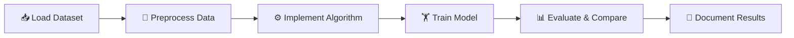

<!-- ===================== HEADER ===================== -->
<div align="center">


<a href="https://git.io/typing-svg">
  
</a>

<br><br>


<br>


</div>

---

## 📖 Table of Contents

- [About the Project](#-about-the-project)
- [Student Information](#-student-information)
- [Practicals Index](#-practicals-index)
- [Practical Details](#-practical-details)
- [Algorithm Comparison](#-algorithm-comparison)
- [Workflow](#-workflow)
- [Tech Stack](#-tech-stack)
- [Repository Structure](#-repository-structure)
- [Getting Started](#-getting-started)
- [Roadmap](#-roadmap)
- [Learning Outcomes](#-learning-outcomes)
- [Contact](#-contact)

---

## 🚀 About the Project

This repository is a **complete record of my Machine Learning practical work** at **Hazara University**.

Most people call `model.fit()` and hope for the best. Here, every algorithm is
**implemented from scratch**, explained step by step, and evaluated properly, so the
logic behind each model is clear.

> 💡 **Philosophy:** *If you can build it from scratch, you truly understand it.*

---

## 👨‍🎓 Student Information

<div align="center">

| | |
|:--|:--|
| 👤 **Name** | Shahabuddin |
| 📘 **Subject** | Machine Learning |
| 🏫 **University** | Hazara University |
| 🎯 **Repository Aim** | Practical work of Machine Learning |

</div>

---

## 📚 Practicals Index

| # | Practical | Topic | Concepts | Status |
|:-:|-----------|-------|----------|:------:|
| 01 | [Find-S Algorithm](./01_Find-S_Algorithm/) | Concept Learning | Most specific hypothesis | ✅ Completed |
| 02 | [ID3, C4.5 & CART](./02_Decision_Trees/) | Decision Trees | Info Gain, Gain Ratio, Gini | ✅ Completed |
| 03 | _Coming soon_ | - | - | ⏳ Planned |
| 04 | _Coming soon_ | - | - | ⏳ Planned |

> 📝 This table is updated whenever a new practical is added.

---

## 🔍 Practical Details

<details open>
<summary><b>🔹 Practical 01: Find-S Algorithm</b></summary>
<br>

| Item | Description |
|------|-------------|
| **Goal** | Find the most specific hypothesis consistent with all positive examples |
| **Dataset** | EnjoySport |
| **Approach** | Start with the first positive example and generalize mismatched attributes to `?` |
| **Final Output** | `['Sunny', 'Warm', '?', 'Strong', '?', '?']` |

</details>

<details open>
<summary><b>🔹 Practical 02: ID3, C4.5 and CART Decision Trees</b></summary>
<br>

| Item | Description |
|------|-------------|
| **Goal** | Implement three decision tree algorithms from scratch and compare them |
| **Dataset** | PlayTennis |
| **Split Criteria** | Information Gain (ID3), Gain Ratio (C4.5), Gini Index (CART) |
| **Evaluation** | Training accuracy, Leave-One-Out CV, depth, nodes, leaves, fit time |

</details>

<details>
<summary><b>🔹 Practical 03 onwards</b></summary>
<br>

_New practicals will be documented here as the course progresses._

</details>

---

## ⚖️ Algorithm Comparison

| Feature | 🌳 ID3 | 🌲 C4.5 | 🌴 CART |
|---------|:------:|:------:|:------:|
| **Split criterion** | Information Gain | Gain Ratio | Gini Index |
| **Split type** | Multi-way | Multi-way / threshold | Binary |
| **Continuous data** | ❌ | ✅ | ✅ |
| **Missing values** | ❌ | ✅ | ✅ |
| **Pruning** | ❌ | ✅ | ✅ |
| **Regression** | ❌ | ❌ | ✅ |

---

## 🔄 Workflow



---

## 🛠️ Tech Stack

| Category | Tools |
|----------|-------|
| **Language** | Python 🐍 |
| **Data & ML** | Pandas, NumPy, Scikit-learn |
| **Visualization** | Matplotlib |
| **Environment** | Jupyter Notebook, VS Code |
| **Version Control** | Git, GitHub |

---

## 📁 Repository Structure

```
Machine-Learning-Practicals/
│
├── 📂 01_Find-S_Algorithm/
│   └── 📓 find_s.ipynb
│
├── 📂 02_Decision_Trees/
│   └── 📓 id3_c45_cart.ipynb
│
├── 📂 data/
│
├── 📄 requirements.txt
├── 📄 LICENSE
└── 📄 README.md
```

---

## ⚡ Getting Started

**1. Clone the repository**
```bash
git clone https://github.com/YOUR_USERNAME/Machine-Learning-Practicals.git
cd Machine-Learning-Practicals
```

**2. (Optional) Create a virtual environment**
```bash
python -m venv venv
venv\Scripts\activate        # Windows
source venv/bin/activate     # Linux / macOS
```

**3. Install dependencies**
```bash
pip install -r requirements.txt
```

**4. Launch Jupyter Notebook**
```bash
jupyter notebook
```

Open any practical folder and run the cells from top to bottom.

<details>
<summary><b>📄 requirements.txt</b></summary>

```
pandas
numpy
matplotlib
scikit-learn
jupyter
```

</details>

---

## 🗺️ Roadmap

- [x] Find-S Algorithm
- [x] ID3, C4.5 and CART comparison
- [ ] Candidate Elimination Algorithm
- [ ] Linear and Logistic Regression
- [ ] K-Nearest Neighbors (KNN)
- [ ] Naive Bayes Classifier
- [ ] K-Means Clustering
- [ ] Neural Network basics

---

## 🎓 Learning Outcomes

- ✅ Understand how ML algorithms work internally
- ✅ Implement algorithms in pure Python without black-box libraries
- ✅ Compare models using proper evaluation metrics
- ✅ Write clean, documented and reproducible code

---

## 📬 Contact

<div align="center">

<a href="mailto:haidershahabuddin@gmail.com">
  
</a>

</div>

---

<div align="center">

### ⭐ If this repository helped you, please give it a star! ⭐

**Made with ❤️ by Shahabuddin | Hazara University**


</div>
